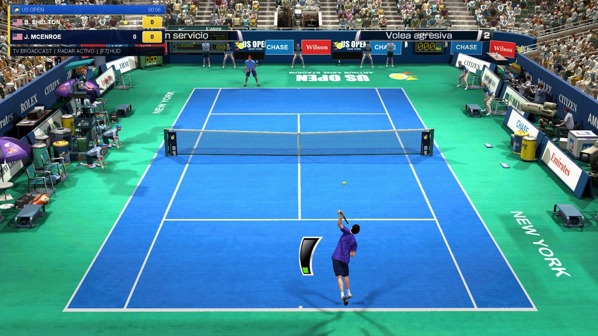
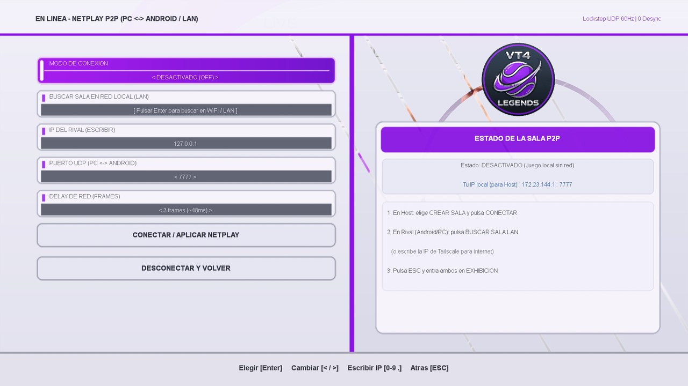

<p align="center">
  
</p>

<h1 align="center">Virtua Tennis 4: Legends &amp; Next-Gen Edition</h1>

<p align="center">
  <em>Ingeniería inversa nativa, cargador <code>xlive.dll</code> sin GFWL y overhaul completo de Virtua Tennis 4 para PC y Android.</em>
</p>

<p align="center">
  <a href="README.md"></a>
  <a href="README.es.md"></a>
</p>

<p align="center">
  
  
  
  
  
  
</p>

<p align="center">
  <a href="#-características-principales">Características</a> •
  <a href="#-galería">Galería</a> •
  <a href="#-instalación-rápida">Instalación</a> •
  <a href="#-compilación-y-herramientas">Compilación</a> •
  <a href="#-controles-y-atajos">Controles</a> •
  <a href="#-benchmarks-reales">Benchmarks</a> •
  <a href="#-faq-y-solución-de-problemas">FAQ</a>
</p>

---

> [!IMPORTANT]
> **Aviso Legal:** Este repositorio contiene exclusivamente código fuente propio del mod (`src/`), herramientas de generación (`tools/`), capturas y documentación. **No incluye ni distribuye archivos, ejecutables ni assets originales de SEGA** (`VT4.exe`, `vt4.dll`, `resource*.bin`, modelos o texturas base). Requiere una copia legítima de *Virtua Tennis 4* para PC.

---

## ✨ Características Principales

### 🏆 Roster Histórico &amp; Next-Gen de 84 Tenistas (`IDs 0..83`)
- **Paginación nativa en `CharaSelect`** (`Q` / `E` o `LB` / `RB`) ampliada de 26 a **84 jugadores jugables** distribuidos en **4 páginas por épocas**, conservando intactos todos los personajes originales.
- **59 modelos 3D `.sdo` personalizados**: cabezas esculpidas en 3D, **caras UV 3D personalizadas** ([local_identity_uv.py](tools/local_identity_uv.py) / [studio_face_factory.py](tools/studio_face_factory.py)), ojos HD con supersampling 4x, pelo volumétrico y escalado físico de huesos.
- **84/84 retratos 2D a todo color** (`photo_L`, `photo_eye`, `photo_S`), **nombres reales en marcador y pantalla de carga** (`hk_StoLookup` + `hk_Loading_SetPlayerPhoto`), estadísticas individualizadas ([player_stats.h](src/xlive/player_stats.h)) y tabla de voces para 84 IDs ([voice_packs.h](src/xlive/voice_packs.h)).
- **Desbloqueo total (`EXTRA-1`)** de leyendas, jefes SEGA (`King`, `Duke`, `T. Tenniel`, `V. Virnie`), estadios y catálogo SPT de serie.

<details>
<summary><b>Ver las 4 páginas completas del Roster (84 tenistas)</b></summary>

- **Página 1/4 — Era Actual &amp; Next-Gen (2015–2026)**: Federer, Nadal, Djokovic, Alcaraz, Sinner, Medvedev, Zverev, Tsitsipas, Rublev, Ruud, Fritz, Shelton, Kyrgios, Świątek, Sabalenka, Gauff, Rybakina, Badosa, Andreeva, Muguruza, Halep.
- **Página 2/4 — Era Dorada (2000s–2010s)**: Del Potro, Murray, Wawrinka, Roddick, Hewitt, Safin, Ferrero, Moyá, Ferrer, Nalbandian, Coria, Tsonga, Monfils, Gasquet, Nishikori, González, Haas, Söderling, Berdych, Thiem, Serena Williams.
- **Página 3/4 — Leyendas 90s &amp; WTA Clásica**: Sampras, Agassi (`[F]` skin doble `'91` / `'06`), Courier, Becker, Edberg, Rafter, Ivanišević, Kuerten, Chang, Ríos, Muster, Bruguera, Corretja, Graf, Seles, Henin, Clijsters, Sánchez Vicario, Conchita Martínez, Venus Williams, Sharapova.
- **Página 4/4 — Pioneros 60s–80s &amp; Clásicos VT4**: Borg, McEnroe, Lendl, Connors, Vilas, Wilander, Laver, Navratilova, Evert, Billie Jean King, Wozniacki, Kuznetsova, Ivanovic, Chakvetadze, Robson, Kohlschreiber, Seppi, King, Duke, T. Tenniel, V. Virnie.

</details>

### 🏟️ 4 Grand Slams Oficiales + Mutua Madrid Open (Tierra Azul)
- **Australian Open (`Aus1`)**: Pista azul Melbourne y patrocinadores modernos (Kia, Rolex, Emirates, Ralph Lauren, Yonex).
- **Roland-Garros (`Fra1`)**: Tierra batida parisina y lonas Philippe-Chatrier (BNP Paribas, Rolex, Renault, Lacoste, Emirates, Babolat).
- **Wimbledon (`Eng1`)**: Hierba esmeralda con desgaste natural y lonas verde/púrpura (Rolex, IBM, Slazenger, Ralph Lauren, Barclays, evian).
- **US Open (`Usa1`)**: Pista azul Arthur Ashe + bordes verdes US Open (Chase, Wilson, Rolex, IBM, Emirates, Citizen) sin artefactos especulares heredados.
- **Mutua Madrid Open (`Spa2`)**: Pista de **Tierra Azul** generada vía [make_madrid_blue_clay.py](tools/make_madrid_blue_clay.py).
- **Física diferenciada por superficie + `ProPhysics`**: Parámetros dedicados en `fwDataDB_Stage.txt` (bote alto/lento en arcilla `0.95/0.70`, bajo/rápido en hierba `0.58/0.90`), selector de velocidad (`0.90x` / `1.00x` / `1.20x` / `1.35x`), **Reglas Grand Slam (5 Sets x 6 Juegos)** y **Cámara TV Clásica fija**.

### 📺 Marcadores TV Oficiales en Vivo (`[F7]`) y Motor NextGenFX
- **Overlay Broadcast TV modular** ([broadcast_hud.h](src/xlive/broadcast_hud.h), [build_official_scoreboards.py](tools/build_official_scoreboards.py)): 6 temas oficiales (`AO`, `RG`, `WIM`, `USO`, `MAD`, `TOUR`) + atlas de 27 banderas COI.
- **Telemetría directa desde RAM**: sets, juegos, puntos/ventajas, turno de saque, avisos de *Break / Set / Match Point*, radar `km/h` calibrado y contador de `RALLY`.
- **NextGenFX y Frame Pacer de precisión**: corrección de viewport D3D9 en Windows 10/11, limpieza de *DOF blur/bloom* (`CleanPostFX`), nitidez adaptativa (`NextGenSharpen`), gradación fílmica (`NextGenFilmic`), fix del resto con teclado (`Player+0x248`) y eliminación del bug de doble VSync (`30.77 -> 60.00 FPS`).

### 🌐 Online P2P Crossplay + Multiverso Arcade + Android 1-Toque
- **Menú `EN LÍNEA` nativo VT4 + Auto-Descubrimiento LAN** ([netplay.h](src/xlive/netplay.h)): pantalla completa nacarada/púrpura con escaneo UDP en red local (`Crear Sala` / `Buscar Sala LAN`) y juego por Internet vía Tailscale (`PC <-> Android`).
- **5 Easter Eggs "Multiverso Arcade"** ([multiverse_modes.h](src/xlive/multiverse_modes.h)): protesta al juez de silla con McEnroe (`EE-1`, `[C]` + QTE), pista partida **50% Hielo / 50% Barro** (`EE-2`), **Raqueta Madera / Sartén / Baguette** (`EE-3`, `[R]`), **Super Golpes DBZ** (`EE-4`) y **Jefes Secretos** (`EE-5`).
- **Portabilidad Android Llave en Mano** ([export_android_bundle.py](tools/export_android_bundle.py)): lanzador nativo Win32 **`PLAY_VT4_LEGENDS.exe`** para arranque de 1 toque en **GameHub** y **Winlator CMod/Frost**, perfil móvil `PerfProfile=2` (0 syscalls FUSE) y **Mando Xbox Táctil interactivo (`[F6]`)** ([touch_gamepad.h](src/xlive/touch_gamepad.h)).

---

## 📸 Galería

<table>
  <tr>
    <td align="center" width="50%">
      
      <br/><sub><b>Wimbledon (Eng1)</b> — Alcaraz vs Sinner · Marcador TV oficial + radar 152 km/h</sub>
    </td>
    <td align="center" width="50%">
      
      <br/><sub><b>Roland-Garros (Fra1)</b> — Świątek vs Sabalenka · Tierra batida Philippe-Chatrier</sub>
    </td>
  </tr>
  <tr>
    <td align="center" width="50%">
      
      <br/><sub><b>US Open (Usa1)</b> — Shelton vs McEnroe · Arthur Ashe Stadium</sub>
    </td>
    <td align="center" width="50%">
      
      <br/><sub><b>Roster de 84 Tenistas</b> — 4 páginas por épocas y retratos 2D a todo color</sub>
    </td>
  </tr>
  <tr>
    <td align="center" width="50%">
      
      <br/><sub><b>EN LÍNEA P2P</b> — Interfaz nativa VT4 con auto-descubrimiento LAN UDP</sub>
    </td>
    <td align="center" width="50%">
      
      <br/><sub><b>Multiverso Arcade (EE-2)</b> — Batalla de las Superficies 50% Hielo / 50% Barro</sub>
    </td>
  </tr>
</table>

---

## 🚀 Instalación Rápida

### Para Jugadores (Windows &amp; Android)

1. **Requisitos previos**:
   - Una instalación legítima de *Virtua Tennis 4* para PC (`VT4.exe`, `vt4.dll`, `resource.bin`, `resource.1.bin`).
   - En Android: **GameHub (GameFusion)** o **Winlator CMod / Frost** (Turnip en Adreno, Vortek en Mali).
2. **En PC (Windows)**:
   - Descarga el paquete de código/release (sin binarios SEGA) o compila `xlive.dll` (ver abajo).
   - Copia `xlive.dll`, `PLAY_VT4_LEGENDS.exe`, `vt4_settings.ini` y los archivos de `archive/` dentro de tu carpeta `game/` junto a `VT4.exe`.
   - Lanza **`VT4.exe`** (o **`PLAY_VT4_LEGENDS.exe`**) y configura opciones visuales en **Opciones -> Gráficos HD y Legends (`F2`)**.
3. **En Android (1 Toque)**:
   - Genera tu paquete autónomo limpio en `dist/android/VT4_Legends_Android/`:
     ```powershell
     py -u tools/export_android_bundle.py
     ```
   - Copia `VT4_Legends_Android/` a una ruta corta de tu memoria interna (p. ej. `/storage/emulated/0/Games/VT4_Legends_Android/`).
   - **GameHub**: *Import PC Game* -> selecciona **`PLAY_VT4_LEGENDS.exe`**.
   - **Winlator CMod/Frost**: clic derecho en **`PLAY_VT4_LEGENDS.exe`** -> *Create Shortcut* -> en *Shortcuts* pulsa `⋮` -> *Add to Home Screen*.
   - Guía completa de ajustes DXVK/Turnip y netplay: [ANDROID_SETUP_GUIDE.md](ANDROID_SETUP_GUIDE.md) y [ONLINE_NETPLAY_GUIDE.md](ONLINE_NETPLAY_GUIDE.md).

---

## ⚙️ Compilación y Herramientas

### Para Desarrolladores (desde código fuente)

Dependencias locales: compilador Zig x86 en `tools/zig/zig.exe` y Python 3.14 (`py -u` con `Pillow`, `numpy`, `opencv-python`).

```powershell
# 1. Compilar game/xlive.dll (Zig x86)
powershell -ExecutionPolicy Bypass -File src/xlive/build.ps1

# 2. (Opcional) Regenerar los 4 Grand Slams en game/archive/HIGH/Stage/
py -u tools/build_grand_slam_stages.py

# 3. Exportar bundle Android completo (compila PLAY_VT4_LEGENDS.exe + auditoría case-sensitive)
py -u tools/export_android_bundle.py

# 4. Ejecutar QA automatizado de roster o menú de opciones
py -u tools/tests/test_roster_matrix.py --ids 60,61,62,64,65,66,67,68,69,70,71,72,74,75,76,77,80,81,82,83 --cpu 0 --mv 3
py -u tools/tests/test_options_ui.py
```

---

## 🎮 Controles y Atajos

| Contexto | Tecla / Botón | Función |
|---|---|---|
| Global / En juego | `F2` | Abrir menú **Gráficos HD y Legends** |
| Global / En juego | `F6` | Mostrar / ocultar **Mando Xbox Táctil (`TouchXboxHUD`)** |
| En partido | `F7` | Activar / ocultar **Marcadores TV Oficiales (`BroadcastHUD`)** |
| En partido | `F10` | Captura limpia del backbuffer D3D9 (`vt4_present_*.png`) |
| `CharaSelect` | `Q` / `E` (`LB` / `RB`) | Cambiar entre las **4 páginas de roster** |
| `CharaSelect` | `F` | Alternar skin **Agassi '91 / '06** |
| `CharaSelect` | `R` | Cambiar arma arcade **EE-3** (Normal / Madera / Sartén / Baguette) |
| En partido (`EE-1`) | `C` | Protestar al juez de silla (QTE con `Z` / `Espacio`) |
| Tenis (P1 teclado) | Flechas + `Enter` / `Esc` / `Z` / `V` | Moverse + Topspin / Slice / Globo / Dejada (XInput / DirectInput nativo) |

---

## 📊 Benchmarks Reales

Mediciones tomadas en partido de Exhibición (300 frames, audio nativo XAudio2 activo, `0` crashes):

| Métrica | VT4 Original (`VSync=1`) | VT4 (`VSync=0`) | Mod `PerfProfile=0` (Ultra PC) | Mod `PerfProfile=2` (Android / Winlator) |
|---|---:|---:|---:|---:|
| **FPS Medios** | 30.77 | 60.24 | **60.00 (+95.0 %)** | **60.00** |
| **1% Low FPS** | 28.12 | 45.27 | **59.93 (+113.1 %)** | **59.92** |
| **Frame Time Avg / P99 / Max** | 32.50 / 34.76 / 36.90 ms | 16.60 / 16.99 / 28.62 ms | **16.67 / 16.67 / 16.72 ms** | **16.67 / 16.67 / 16.70 ms** |
| **Jitter (max - min)** | 5.90 ms | 12.48 ms | **0.10 ms** | **0.06 ms** |
| **Syscalls I/O (`GetFileAttributesA`)** | 2,453 | 2,448 | **0 (-100 %)** | **0 (-100 %)** |
| **Crashes / Asserts** | 28 | 0 | **0 (`ps=0 ex=0 exc=0`)** | **0 (`ps=0 ex=0 exc=0`)** |

---

## ❓ FAQ y Solución de Problemas

<details>
<summary><b>El juego arranca con los 26 jugadores originales y no aparecen los 84</b></summary>
Wine / Windows no cargó nuestro <code>xlive.dll</code>. En Android/Wine ejecuta siempre <code>PLAY_VT4_LEGENDS.exe</code> (o fija <code>WINEDLLOVERRIDES="xlive,d3dx9_43,msvcr90,msvcp90,msvcm90=n,b"</code>).
</details>

<details>
<summary><b>No se oye el sonido o se entrecorta en Winlator / GameHub</b></summary>
Configura <code>xaudio2_7=n</code> (Native) y selecciona <b>PulseAudio</b> como driver de audio en el contenedor.
</details>

<details>
<summary><b>Pantalla negra o caídas en móviles Mali / Exynos</b></summary>
Usa <code>AntiAliasing=0</code>, <code>CleanPostFX=1</code>, <code>PerfProfile=2</code> en <code>vt4_settings.ini</code> (ya preconfigurados por <code>export_android_bundle.py</code>) y driver <b>Vortek</b> + <b>DXVK</b>.
</details>

<details>
<summary><b>¿Cómo juego online con un amigo entre PC y Android?</b></summary>
Entrad ambos en <b>EN LÍNEA</b> desde el menú principal: en el mismo WiFi uno crea sala y el otro pulsa <b>BUSCAR SALA EN RED LOCAL (LAN)</b>; por Internet usad <b>Tailscale</b> introduciendo la IP <code>100.x.x.x</code> del rival.
</details>

---

## 🛠️ Estructura del Proyecto

```text
├── docs/screenshots/                   # Galería oficial de capturas y escudo
├── src/
│   ├── launcher/
│   │   └── play_vt4_legends.c          # Lanzador Win32 1-toque (WINEDLLOVERRIDES + espera síncrona)
│   └── xlive/
│       ├── xlive.c                     # Mod Loader nativo (GFWL bypass, D3D9, PlayerDB, hooks motor)
│       ├── broadcast_hud.h             # Marcadores TV oficiales [F7] + radar km/h y RALLY
│       ├── touch_gamepad.h             # Mando Xbox táctil interactivo [F6]
│       ├── player_stats.h              # Estadísticas individualizadas (IDs 26..83)
│       ├── voice_packs.h               # Tabla de packs de voz (84 IDs)
│       ├── multiverse_modes.h          # Easter Eggs EE-1..EE-5 (Ice/Mud, armas 3D, estelas)
│       ├── nextgen_fx.h / perf_opt.h   # Shaders NextGenFX y perfiles de rendimiento
│       ├── netplay.h                   # Sincronización P2P Lockstep + descubrimiento LAN UDP
│       └── xlive.def / build.ps1       # Exportaciones XLive y compilación Zig x86
├── tools/
│   ├── build_grand_slam_stages.py      # Generador BC1/BC3 + LZSS (AO, RG, Wimbledon, US Open)
│   ├── build_official_scoreboards.py   # Generador de overlays TV y atlas de banderas IOC
│   ├── build_netplay_ui_assets.py      # Generador de sprites del menú EN LÍNEA
│   ├── make_madrid_blue_clay.py        # Generador de Tierra Azul de Madrid (Spa2FS/D)
│   ├── build_all_sdo_models.py         # Pipeline de modelos 3D .sdo / .zml y escalado físico
│   ├── studio_face_factory.py          # Esculpido 3DMM + pelo 3D + UV faciales
│   ├── local_identity_uv.py            # Transferencia biométrica facial a UV 1024x1024
│   ├── pack_colorized_bw_portraits.py  # Empaquetado 84/84 retratos 2D a color
│   ├── export_android_bundle.py        # Exportador Android + PLAY_VT4_LEGENDS.exe + audit case
│   └── tests/                          # Suites QA automatizadas (test_roster_matrix, test_options_ui)
├── ROADMAP_ROSTER.md                   # Hoja de ruta y registro maestro del roster (84/84)
├── MODLOG.md                           # Historial técnico de sesiones y verificaciones
├── RELEASE_NOTES_v1.0.md               # Notas oficiales de lanzamiento v1.0
├── ONLINE_NETPLAY_GUIDE.md             # Guía de netplay P2P y LAN
└── ANDROID_SETUP_GUIDE.md              # Guía de portabilidad Android (GameHub / Winlator)
```
