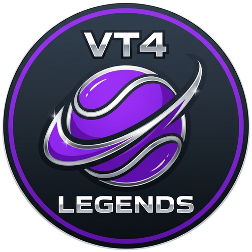
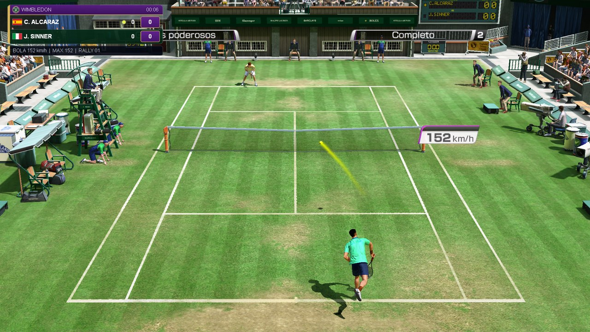
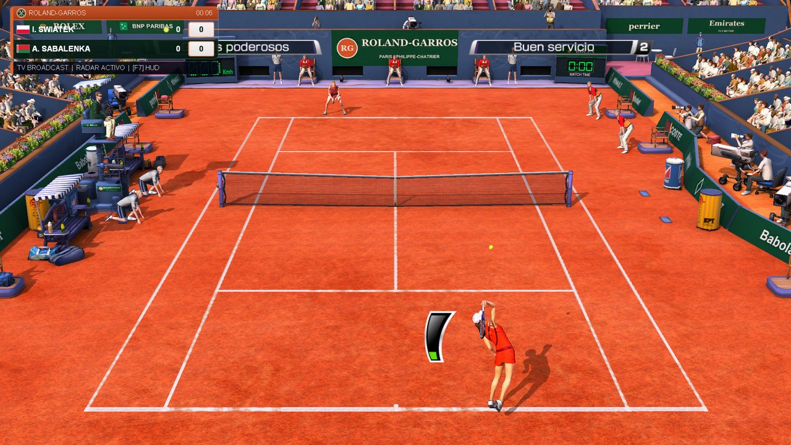
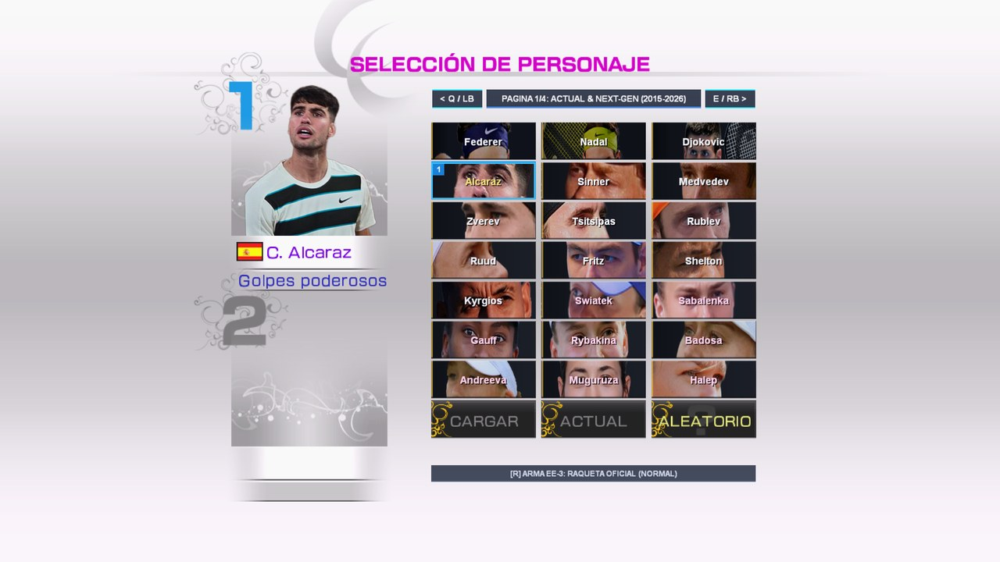
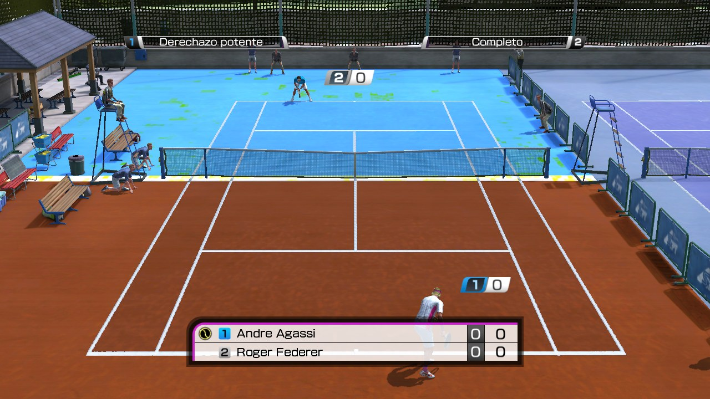

<p align="center">
  
</p>

<h1 align="center">Virtua Tennis 4: Legends &amp; Next-Gen Edition</h1>

<p align="center">
  <em>Ingeniería inversa nativa, cargador <code>xlive.dll</code> sin GFWL y overhaul completo de Virtua Tennis 4 para PC y Android.</em>
</p>

<p align="center">
  <a href="README.md"></a>
  <a href="README.es.md"></a>
</p>

<p align="center">
  
  
  
  
  
  
  
</p>

<p align="center">
  <a href="#-características-principales">Características</a> •
  <a href="#-galería">Galería</a> •
  <a href="#-instalación-rápida">Instalación</a> •
  <a href="#-compilación-y-herramientas">Compilación</a> •
  <a href="#-controles-y-atajos">Controles</a> •
  <a href="#-benchmarks-reales">Benchmarks</a> •
  <a href="#-faq-y-solución-de-problemas">FAQ</a>
</p>

---

> [!IMPORTANT]
> **Aviso Legal:** Este repositorio contiene exclusivamente código fuente propio del mod (`src/`), herramientas de generación (`tools/`), capturas y documentación. **No incluye ni distribuye archivos, ejecutables ni assets originales de SEGA** (`VT4.exe`, `vt4.dll`, `resource*.bin`, modelos o texturas base). Requiere una copia legítima de *Virtua Tennis 4* para PC.

> [!NOTE]
> **Proyecto en Desarrollo (`WIP`) y Modo Núcleo Seguro:** Este proyecto está **WIP** (Work In Progress) como cargador nativo Win32 por ingeniería inversa (`xlive.dll`) + pipeline de assets, no una decompilación completa a C. Como la descarga de GitHub (`VT4_Legends-v1.0.1-Windows-x86.zip`, **0 `.exe`**) no incluye archivos de SEGA, al copiarla sobre tu copia PC arranca limpia en **Modo Núcleo Seguro** (`26` jugadores originales + jefes desbloqueados + 60 FPS, NextGenFX, Marcadores TV, ProPhysics, `4:3`/16:10, Netplay LAN y parches Linux/Winlator). Para generar los 84 jugadores 3D y Grand Slams en local, usa los scripts de `tools/`.

---

## ✨ Características Principales

### 🏆 Roster Histórico &amp; Next-Gen de 84 Tenistas (`IDs 0..83`)
- **Paginación nativa en `CharaSelect`** (`Q` / `E` o `LB` / `RB`) ampliada de 26 a **84 jugadores jugables** distribuidos en **4 páginas por épocas**, conservando intactos todos los personajes originales.
- **59 modelos 3D `.sdo` personalizados**: cabezas esculpidas en 3D, **caras UV 3D personalizadas** ([local_identity_uv.py](tools/local_identity_uv.py) / [studio_face_factory.py](tools/studio_face_factory.py)), ojos HD con supersampling 4x, pelo volumétrico y escalado físico de huesos.
- **84/84 retratos 2D a todo color** (`photo_L`, `photo_eye`, `photo_S`), **nombres reales en marcador y pantalla de carga** (`hk_StoLookup` + `hk_Loading_SetPlayerPhoto`), estadísticas individualizadas ([player_stats.h](src/xlive/player_stats.h)) y tabla de voces para 84 IDs ([voice_packs.h](src/xlive/voice_packs.h)).
- **Desbloqueo total (`EXTRA-1`)** de leyendas, jefes SEGA (`King`, `Duke`, `T. Tenniel`, `V. Virnie`), estadios y catálogo SPT de serie.

<details>
<summary><b>Ver las 4 páginas completas del Roster (84 tenistas)</b></summary>

- **Página 1/4 — Era Actual &amp; Next-Gen (2015–2026)**: Federer, Nadal, Djokovic, Alcaraz, Sinner, Medvedev, Zverev, Tsitsipas, Rublev, Ruud, Fritz, Shelton, Kyrgios, Świątek, Sabalenka, Gauff, Rybakina, Badosa, Andreeva, Muguruza, Halep.
- **Página 2/4 — Era Dorada (2000s–2010s)**: Del Potro, Murray, Wawrinka, Roddick, Hewitt, Safin, Ferrero, Moyá, Ferrer, Nalbandian, Coria, Tsonga, Monfils, Gasquet, Nishikori, González, Haas, Söderling, Berdych, Thiem, Serena Williams.
- **Página 3/4 — Leyendas 90s &amp; WTA Clásica**: Sampras, Agassi (`[F]` skin doble `'91` / `'06`), Courier, Becker, Edberg, Rafter, Ivanišević, Kuerten, Chang, Ríos, Muster, Bruguera, Corretja, Graf, Seles, Henin, Clijsters, Sánchez Vicario, Conchita Martínez, Venus Williams, Sharapova.
- **Página 4/4 — Pioneros 60s–80s &amp; Clásicos VT4**: Borg, McEnroe, Lendl, Connors, Vilas, Wilander, Laver, Navratilova, Evert, Billie Jean King, Wozniacki, Kuznetsova, Ivanovic, Chakvetadze, Robson, Kohlschreiber, Seppi, King, Duke, T. Tenniel, V. Virnie.

</details>

### 🏟️ 4 Grand Slams Oficiales + Mutua Madrid Open (Tierra Azul)
- **Australian Open (`Aus1`)**: Pista azul Melbourne y patrocinadores modernos (Kia, Rolex, Emirates, Ralph Lauren, Yonex).
- **Roland-Garros (`Fra1`)**: Tierra batida parisina y lonas Philippe-Chatrier (BNP Paribas, Rolex, Renault, Lacoste, Emirates, Babolat).
- **Wimbledon (`Eng1`)**: Hierba esmeralda con desgaste natural y lonas verde/púrpura (Rolex, IBM, Slazenger, Ralph Lauren, Barclays, evian).
- **US Open (`Usa1`)**: Pista azul Arthur Ashe + bordes verdes US Open (Chase, Wilson, Rolex, IBM, Emirates, Citizen) sin artefactos especulares heredados.
- **Mutua Madrid Open (`Spa2`)**: Pista de **Tierra Azul** generada vía [make_madrid_blue_clay.py](tools/make_madrid_blue_clay.py).
- **Física diferenciada por superficie + `ProPhysics`**: Parámetros dedicados en `fwDataDB_Stage.txt` (bote alto/lento en arcilla `0.95/0.70`, bajo/rápido en hierba `0.58/0.90`), selector de velocidad (`0.90x` / `1.00x` / `1.20x` / `1.35x`), **Reglas Grand Slam (5 Sets x 6 Juegos)** y **Cámara TV Clásica fija**.

### 📺 Marcadores TV Oficiales en Vivo (`[F7]`) y Motor NextGenFX
- **Overlay Broadcast TV modular** ([broadcast_hud.h](src/xlive/broadcast_hud.h), [build_official_scoreboards.py](tools/build_official_scoreboards.py)): 6 temas oficiales (`AO`, `RG`, `WIM`, `USO`, `MAD`, `TOUR`) + atlas de 27 banderas COI.
- **Telemetría directa desde RAM**: sets, juegos, puntos/ventajas, turno de saque, avisos de *Break / Set / Match Point*, radar `km/h` calibrado y contador de `RALLY`.
- **NextGenFX y Frame Pacer de precisión**: corrección de viewport D3D9 en Windows 10/11, limpieza de *DOF blur/bloom* (`CleanPostFX`), nitidez adaptativa (`NextGenSharpen`), gradación fílmica (`NextGenFilmic`), fix del resto con teclado (`Player+0x248`) y eliminación del bug de doble VSync (`30.77 -> 60.00 FPS`).

### 🌐 Online P2P Crossplay + Multiverso Arcade + Android 1-Toque
- **Menú `EN LÍNEA` nativo VT4 + Auto-Descubrimiento LAN** ([netplay.h](src/xlive/netplay.h)): pantalla completa nacarada/púrpura con escaneo UDP en red local (`Crear Sala` / `Buscar Sala LAN`) y juego por Internet vía Tailscale (`PC <-> Android`).
- **5 Easter Eggs "Multiverso Arcade"** ([multiverse_modes.h](src/xlive/multiverse_modes.h)): protesta al juez de silla con McEnroe (`EE-1`, `[C]` + QTE), pista partida **50% Hielo / 50% Barro** (`EE-2`), **Raqueta Madera / Sartén / Baguette** (`EE-3`, `[R]`), **Super Golpes DBZ** (`EE-4`) y **Jefes Secretos** (`EE-5`).
- **Portabilidad Android Llave en Mano** ([export_android_bundle.py](tools/export_android_bundle.py)): lanzador nativo Win32 **`PLAY_VT4_LEGENDS.exe`** para arranque de 1 toque en **GameHub** y **Winlator CMod/Frost**, perfil móvil `PerfProfile=2` (0 syscalls FUSE) y **Mando Xbox Táctil interactivo (`[F6]`)** ([touch_gamepad.h](src/xlive/touch_gamepad.h)).

---

## 📸 Galería

<table>
  <tr>
    <td align="center" width="50%">
      
      <br/><sub><b>Wimbledon (Eng1)</b> — Alcaraz vs Sinner · Marcador TV oficial + radar 152 km/h</sub>
    </td>
    <td align="center" width="50%">
      
      <br/><sub><b>Roland-Garros (Fra1)</b> — Świątek vs Sabalenka · Tierra batida Philippe-Chatrier</sub>
    </td>
  </tr>
  <tr>
    <td align="center" width="50%">
      
      <br/><sub><b>US Open (Usa1)</b> — Shelton vs McEnroe · Arthur Ashe Stadium</sub>
    </td>
    <td align="center" width="50%">
      
      <br/><sub><b>Roster de 84 Tenistas</b> — 4 páginas por épocas y retratos 2D a todo color</sub>
    </td>
  </tr>
  <tr>
    <td align="center" width="50%">
      
      <br/><sub><b>EN LÍNEA P2P</b> — Interfaz nativa VT4 con auto-descubrimiento LAN UDP</sub>
    </td>
    <td align="center" width="50%">
      
      <br/><sub><b>Multiverso Arcade (EE-2)</b> — Batalla de las Superficies 50% Hielo / 50% Barro</sub>
    </td>
  </tr>
</table>

---

## 🚀 Instalación Rápida y Cómo Jugar

> **Requisitos previos**: Una copia legítima desempaquetada de *Virtua Tennis 4* para PC (`VT4.exe` PC v1.0, `5,059,400` B, `vt4.dll`, `resource.bin`, `resource.1.bin`).

### 🪟 Windows (PC)
1. Descarga **`VT4_Legends-v1.0.1-Windows-x86.zip`** desde Releases (**0 `.exe`** + `SHA256SUMS.txt` para evitar falsos positivos de navegadores).
2. Descomprímelo junto a `VT4.exe` (y opcionalmente ejecuta los scripts de `tools/` para generar los 84 tenistas `.sdo`/retratos y los 4 Grand Slams en `archive/HIGH/`).
3. Abre **`VT4.exe`**: `xlive.dll` valida la firma del ejecutable, crea `save\Config.txt` portátil, adapta `Locale=auto` al idioma del sistema y permite elegir **16:9**, **16:10** o **4:3 Arcade** (`F2` -> *GRÁFICOS HD Y LEGENDS*).

### 🐧 Linux
- **Opción 1 (Script automático)**: Copia `launch_linux.sh` junto a `VT4.exe` y ejecuta `chmod +x launch_linux.sh && ./launch_linux.sh` (autodetecta `umu-run`, Proton o Wine con `WINEDLLOVERRIDES="xlive,d3dx9_43=n,b"`).
- **Opción 2 (Lutris / Bottles / Wine)**: Ejecuta `VT4.exe` fijando **`xlive,d3dx9_43=n,b`** (mantén `msvcr90` y FAudio `xaudio2_7` propios de Wine). Nuestro `xlive.dll` corrige automáticamente `IGameExplorer` (`0x00404f20`) y `SM_REMOTESESSION` (`0x0040533a`).

### 🎮 Steam Deck (SteamOS)
1. Copia los archivos del mod junto a `VT4.exe` y añade **`VT4.exe`** en Steam como **Juego que no es de Steam**.
2. En *Propiedades -> Compatibilidad*, marca forzar compatibilidad y elige **Proton Experimental**.
3. En *Propiedades -> General -> Parámetros de lanzamiento*, pega:
   ```text
   WINEDLLOVERRIDES="xlive,d3dx9_43=n,b" %command%
   ```
   *(También puedes usar `./launch_linux.sh --deck` en Modo Escritorio con resolución nativa **`1280x800` (16:10)** y `PerfProfile=1`.)* Guía completa: [LINUX_STEAMDECK_GUIDE.md](LINUX_STEAMDECK_GUIDE.md).

### 📱 Android (Winlator y GameHub)
1. En PC, exporta la carpeta lista para móvil (o `.zip` único con `--zip`):
   ```powershell
   py -u tools/export_android_bundle.py --zip
   ```
   *(O usa `VT4_Legends-v1.0.1-Android-Launcher.zip` de Releases para añadir **`PLAY_VT4_LEGENDS.exe`** con icono oficial incrustado, `PULSE_LATENCY_MSEC=90` y `DXVK_STATE_CACHE=1` automáticos.)*
2. Copia `VT4_Legends_Android/` a una ruta corta de tu memoria interna (p. ej. `/storage/emulated/0/Games/VT4_Legends_Android/`).
3. **Winlator (Oficial / CMod / Frost)**:
   - Abre el explorador dentro del contenedor -> navega a `VT4_Legends_Android/` -> toca **`PLAY_VT4_LEGENDS.exe`** con **dos dedos** *(clic derecho)* -> **Create Shortcut**.
   - **Winlator Oficial** no incluye *Add to Home Screen*: sal del contenedor y lanza en 1 toque desde la pestaña **Shortcuts** (en `⋮ -> Settings` puedes fijar *Virtual Gamepad*, `960x540` y audio `ALSA`). **Winlator CMod** sí ofrece `⋮ -> Add to Home Screen` para crear icono directo en el escritorio Android.
   - Ya dentro del juego, desliza desde el borde izquierdo -> **Input Controls -> Virtual Gamepad** (`TouchXboxHUD=0` deja la pantalla limpia para el mando multitáctil de Winlator; `[F6]` alterna nuestro HUD opcional).
4. **GameHub (GameFusion)**: **Import PC Game** -> selecciona **`PLAY_VT4_LEGENDS.exe`** (`Turnip + DXVK` en Snapdragon/Adreno, `Vortek + DXVK + ALSA` en MediaTek/Mali, `PerfProfile=2` + `Auto <=540p`). Guía completa: [ANDROID_SETUP_GUIDE.md](ANDROID_SETUP_GUIDE.md).

### 🚀 RecompLauncher
- Incluye [`recomplauncher.json`](recomplauncher.json), `vt4_recomp_prepare.bat` y [`tools/setup_vt4_legends.py`](tools/setup_vt4_legends.py) (`--verify-only` y `prepare`). Guía netplay P2P: [ONLINE_NETPLAY_GUIDE.md](ONLINE_NETPLAY_GUIDE.md).

---

## ⚙️ Compilación y Herramientas

### Para Desarrolladores (desde código fuente)

Dependencias locales: compilador Zig x86 en `tools/zig/zig.exe` y Python 3.14 (`py -u` con `Pillow`, `numpy`, `opencv-python`).

```powershell
# 1. Compilar game/xlive.dll (Zig x86)
powershell -ExecutionPolicy Bypass -File src/xlive/build.ps1

# 2. (Opcional) Regenerar los 4 Grand Slams en game/archive/HIGH/Stage/
py -u tools/build_grand_slam_stages.py

# 3. Exportar bundle Android completo (compila PLAY_VT4_LEGENDS.exe + auditoría case-sensitive)
py -u tools/export_android_bundle.py

# 4. Ejecutar QA automatizado de roster o menú de opciones
py -u tools/tests/test_roster_matrix.py --ids 60,61,62,64,65,66,67,68,69,70,71,72,74,75,76,77,80,81,82,83 --cpu 0 --mv 3
py -u tools/tests/test_options_ui.py
```

---

## 🎮 Controles y Atajos

| Contexto | Tecla / Botón | Función |
|---|---|---|
| Global / En juego | `F2` | Abrir menú **Gráficos HD y Legends** |
| Global / En juego | `F6` | Mostrar / ocultar **Mando Xbox Táctil (`TouchXboxHUD`)** |
| En partido | `F7` | Activar / ocultar **Marcadores TV Oficiales (`BroadcastHUD`)** |
| En partido | `F10` | Captura limpia del backbuffer D3D9 (`vt4_present_*.png`) |
| `CharaSelect` | `Q` / `E` (`LB` / `RB`) | Cambiar entre las **4 páginas de roster** |
| `CharaSelect` | `F` | Alternar skin **Agassi '91 / '06** |
| `CharaSelect` | `R` | Cambiar arma arcade **EE-3** (Normal / Madera / Sartén / Baguette) |
| En partido (`EE-1`) | `C` | Protestar al juez de silla (QTE con `Z` / `Espacio`) |
| Tenis (P1 teclado) | Flechas / `WASD` + `Z`/`J` (Topspin) / `X`/`L` (Slice) / `C`/`K` (Globo/Protesta) / `V`/`I` (Dejada) / `Espacio` (Pausa) / `B` (Cámara) | Soporte completo XInput / DirectInput / Virtual Gamepad (`A` Topspin, `X` Slice, `B` Globo, `Y` Dejada, `START` Pausa, `LB`/`RB` Páginas) |
| HUD del Mod y Android | `F2` (Menú Opciones) / `F6` (Alternar `TouchXboxHUD`) / `F7` (Alternar `BroadcastHUD`) / `F10` (Captura) | Protección automática anti-click-derecho/doble-toque en menús |

---

## 📊 Benchmarks Reales

Mediciones tomadas en partido de Exhibición (300 frames, audio nativo XAudio2 activo, `0` crashes):

| Métrica | VT4 Original (`VSync=1`) | VT4 (`VSync=0`) | Mod `PerfProfile=0` (Ultra PC) | Mod `PerfProfile=2` (Android / Winlator) |
|---|---:|---:|---:|---:|
| **FPS Medios** | 30.77 | 60.24 | **60.00 (+95.0 %)** | **60.00** |
| **1% Low FPS** | 28.12 | 45.27 | **59.93 (+113.1 %)** | **59.92** |
| **Frame Time Avg / P99 / Max** | 32.50 / 34.76 / 36.90 ms | 16.60 / 16.99 / 28.62 ms | **16.67 / 16.67 / 16.72 ms** | **16.67 / 16.67 / 16.70 ms** |
| **Jitter (max - min)** | 5.90 ms | 12.48 ms | **0.10 ms** | **0.06 ms** |
| **Syscalls I/O (`GetFileAttributesA`)** | 2,453 | 2,448 | **0 (-100 %)** | **0 (-100 %)** |
| **Crashes / Asserts** | 28 | 0 | **0 (`ps=0 ex=0 exc=0`)** | **0 (`ps=0 ex=0 exc=0`)** |

---

## ❓ FAQ y Solución de Problemas

<details>
<summary><b>El juego arranca con los 26 jugadores originales y no aparecen los 84 (Modo Núcleo Seguro)</b></summary>
<ul>
<li>Si además aparece la interfaz original de GFWL/LIVE, no se cargó nuestro <code>xlive.dll</code>. En Windows verifica que <code>xlive.dll</code> esté junto a <code>VT4.exe</code>; en Linux/Steam Deck/Wine usa <code>WINEDLLOVERRIDES="xlive,d3dx9_43=n,b"</code>; en Android ejecuta siempre <code>PLAY_VT4_LEGENDS.exe</code>. Comprueba <code>xlive_mod.log</code>.</li>
<li>Si el mod carga pero solo ves 26+2 personajes, está activo el <i>Modo Núcleo Seguro</i> por faltar los packs <code>.sdo</code> / <code>.dds</code> en <code>archive/</code>. Copia los assets manteniendo el case exacto (<code>HIGH/Player/Model/</code>, <code>HIGH/Frontend/VR/photo_L/</code>).</li>
</ul>
</details>

<details>
<summary><b>Error "Fatal Error! User does not have privileges to access this application" o bloqueo en Remote Play</b></summary>
Ocurre en el VT4 original bajo Wine/Proton/Winlator (chequeo de Control Parental <code>IGameExplorer</code> en <code>0x00404f20</code>) o Escritorio Remoto / Steam Remote Play (<code>SM_REMOTESESSION</code> en <code>0x0040533a</code>). Nuestro <code>xlive.dll</code> v1.0.1 parchea ambos chequeos automáticamente al arrancar; verifica en <code>xlive_mod.log</code> que se cargó nuestra DLL.
</details>

<details>
<summary><b>¿Es limpio / legal? ¿Necesito los archivos originales de Virtua Tennis 4 PC?</b></summary>
Sí. Este repositorio y sus descargas contienen <b>cero ejecutables, DLLs ni archivos propietarios de SEGA</b> (<code>VT4_Legends-v1.0.1-Windows-x86.zip</code> tiene 0 <code>.exe</code> y va acompañado de <code>SHA256SUMS.txt</code>). Necesitas tu copia legal de <i>Virtua Tennis 4</i> PC (<code>VT4.exe</code> v1.0 unpacked de <code>5,059,400</code> bytes, <code>sha256: feae98d9...</code>).
</details>

<details>
<summary><b>¿Cómo funcionan los controles en Android / Winlator (Virtual Gamepad vs Touch HUD)?</b></summary>
En Android viene activado por defecto <code>TouchXboxHUD=0</code> para dejar la pantalla limpia usando el <b>Virtual Gamepad</b> multitáctil nativo de Winlator (<i>Menú lateral -> Input Controls -> Virtual Gamepad</i>) o mandos Bluetooth/USB-C. Todos los menús, el resto de saque y el menú personalizado (<code>F2</code> -> <code>GRAFICOS HD Y LEGENDS</code> / <code>EN LINEA</code>) responden directo vía XInput/DirectInput, con protección anti-click-derecho/doble-toque para evitar retrocesos accidentales. Puedes mostrar el overlay integrado en cualquier momento pulsando <code>F6</code>.
</details>

<details>
<summary><b>El juego se ve enmarcado o en formato 4:3 en pantallas panorámicas / Steam Deck / móvil</b></summary>
Por diseño en <code>v1.0.1</code> el motor de presentación mantiene la relación 4:3 con pillarbox limpio dentro de contenedores panorámicos (Steam Deck 16:10 o móviles modernos) y ancla la ventana en <code>(0, 0)</code> sin estirar el HUD. Puedes ajustar escala, MSAA y <code>UseD3D9Ex</code> en <b>OPCIONES -> GRÁFICOS HD Y LEGENDS</b> (<code>F2</code>) o en <code>vt4_settings.ini</code> (<code>[Graphics]</code>).
</details>

<details>
<summary><b>No se oye el sonido o se entrecorta en Winlator / GameHub / Steam Deck</b></summary>
Selecciona <b>PulseAudio</b> como driver de audio en el contenedor y mantén <code>xaudio2_7</code> / <code>msvcr90</code> en el modo <b>Builtin</b> propio de Wine/Proton (FAudio/SxS, por defecto desde <code>v1.0.1</code>; no pongas <code>XAudio2_7.dll</code> ni <code>msvcr90.dll</code> sueltas junto a <code>VT4.exe</code>).
</details>

<details>
<summary><b>Pantalla negra o caídas en móviles Mali / Exynos o GPUs Mesa antiguas</b></summary>
Mantén <code>AntiAliasing=0</code>, <code>CleanPostFX=1</code>, <code>PerfProfile=2</code> en <code>vt4_settings.ini</code> (ya preconfigurados por <code>export_android_bundle.py</code>) y usa <b>Vortek</b> + <b>DXVK</b> en Mali/Exynos (o <b>Turnip</b> + <b>DXVK</b> en Snapdragon/Adreno). En Linux/Mesa, si D3D9Ex falla, fija <code>UseD3D9Ex=0</code>.
</details>

<details>
<summary><b>¿Cómo se inicia en Steam Deck / Linux o mediante RecompLauncher?</b></summary>
<ul>
<li><b>Steam Deck / Linux</b>: añade <code>VT4.exe</code> como juego no-Steam con Proton Experimental y <code>WINEDLLOVERRIDES="xlive,d3dx9_43=n,b" %command%</code> (o ejecuta <code>launch_linux.sh</code>). Guía completa: <a href="LINUX_STEAMDECK_GUIDE.md">LINUX_STEAMDECK_GUIDE.md</a>.</li>
<li><b>RecompLauncher / portable</b>: extrae los archivos y ejecuta <code>vt4_recomp_prepare.bat</code> (usa <code>recomplauncher.json</code> y <code>tools/setup_vt4_legends.py</code>).</li>
</ul>
</details>

<details>
<summary><b>¿Cómo juego online con un amigo entre PC y Android?</b></summary>
Entrad ambos en <b>EN LÍNEA</b> desde el menú principal: en el mismo WiFi uno crea sala y el otro pulsa <b>BUSCAR SALA EN RED LOCAL (LAN)</b>; por Internet usad <b>Tailscale</b> introduciendo la IP <code>100.x.x.x</code> del rival. Guía completa: <a href="ONLINE_NETPLAY_GUIDE.md">ONLINE_NETPLAY_GUIDE.md</a>.
</details>

---

## 🛠️ Estructura del Proyecto

```text
├── docs/screenshots/                   # Galería oficial de capturas y escudo
├── src/
│   ├── launcher/
│   │   └── play_vt4_legends.c          # Lanzador Win32 sin UCRT para Wine/Winlator (WINEDLLOVERRIDES)
│   └── xlive/
│       ├── xlive.c                     # Mod Loader nativo (GFWL/GameExplorer bypass, D3D9, PlayerDB, hooks)
│       ├── broadcast_hud.h             # Marcadores TV oficiales [F7] + radar km/h y RALLY
│       ├── touch_gamepad.h             # Mando Xbox táctil opcional [F6] (Winlator por defecto: Off)
│       ├── player_stats.h              # Estadísticas individualizadas (IDs 26..83)
│       ├── voice_packs.h               # Tabla de packs de voz (84 IDs)
│       ├── multiverse_modes.h          # Easter Eggs EE-1..EE-5 (Ice/Mud, armas 3D, estelas)
│       ├── nextgen_fx.h / perf_opt.h   # Shaders NextGenFX y perfiles de rendimiento
│       ├── netplay.h                   # Sincronización P2P Lockstep + descubrimiento LAN UDP
│       └── xlive.def / build.ps1       # Exportaciones XLive y compilación Zig x86
├── tools/
│   ├── build_grand_slam_stages.py      # Generador BC1/BC3 + LZSS (AO, RG, Wimbledon, US Open)
│   ├── build_official_scoreboards.py   # Generador de overlays TV y atlas de banderas IOC
│   ├── build_netplay_ui_assets.py      # Generador de sprites del menú EN LÍNEA
│   ├── make_madrid_blue_clay.py        # Generador de Tierra Azul de Madrid (Spa2FS/D)
│   ├── build_all_sdo_models.py         # Pipeline de modelos 3D .sdo / .zml y escalado físico
│   ├── studio_face_factory.py          # Esculpido 3DMM + pelo 3D + UV faciales
│   ├── local_identity_uv.py            # Transferencia biométrica facial a UV 1024x1024
│   ├── pack_colorized_bw_portraits.py  # Empaquetado 84/84 retratos 2D a color
│   ├── export_android_bundle.py        # Exportador Android + PLAY_VT4_LEGENDS.exe + audit case
│   ├── package_release.py              # Empaquetado limpio sin .exe (PC) + Launcher Android + SHA256SUMS
│   ├── setup_vt4_legends.py            # Instalador automático y CLI compatible RecompLauncher
│   └── tests/                          # Suites QA automatizadas (test_roster_matrix, test_options_ui, test_clean_portable)
├── launch_linux.sh / recomplauncher.json / vt4_recomp_prepare.bat
├── README.md / README.es.md            # Documentación en inglés y español
├── ROADMAP_ROSTER.md                   # Hoja de ruta y registro maestro del roster (84/84)
├── MODLOG.md                           # Historial técnico de sesiones y verificaciones
├── RELEASE_NOTES_v1.0.md / v1.0.1.md   # Notas oficiales de lanzamiento v1.0 y v1.0.1
├── LINUX_STEAMDECK_GUIDE.md            # Guía para Steam Deck y Linux (Proton)
├── ONLINE_NETPLAY_GUIDE.md             # Guía de netplay P2P y LAN
└── ANDROID_SETUP_GUIDE.md              # Guía de portabilidad Android (GameHub / Winlator)
```
