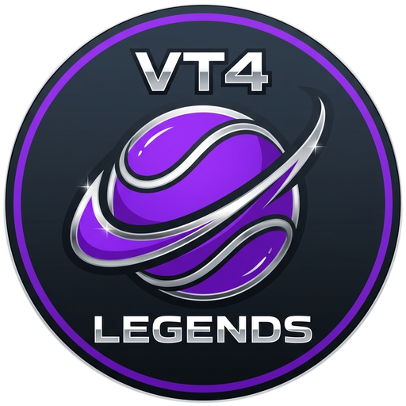
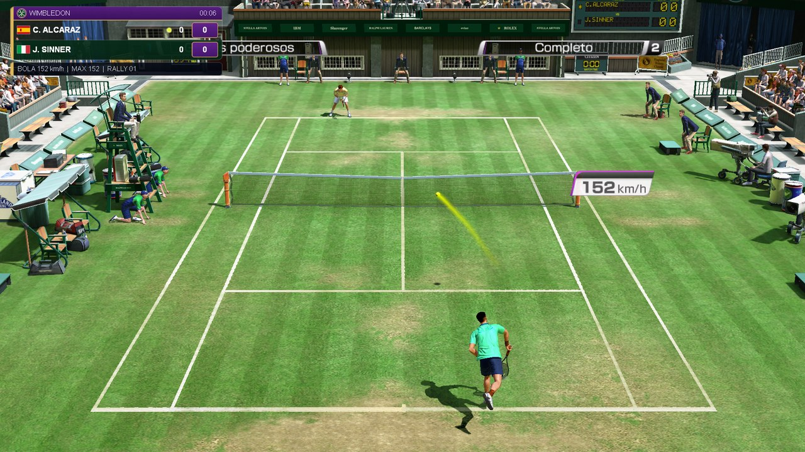
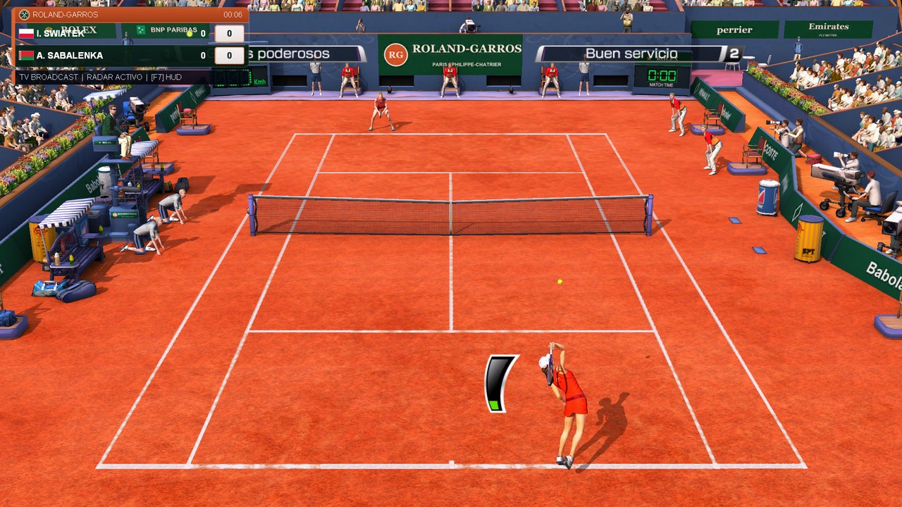
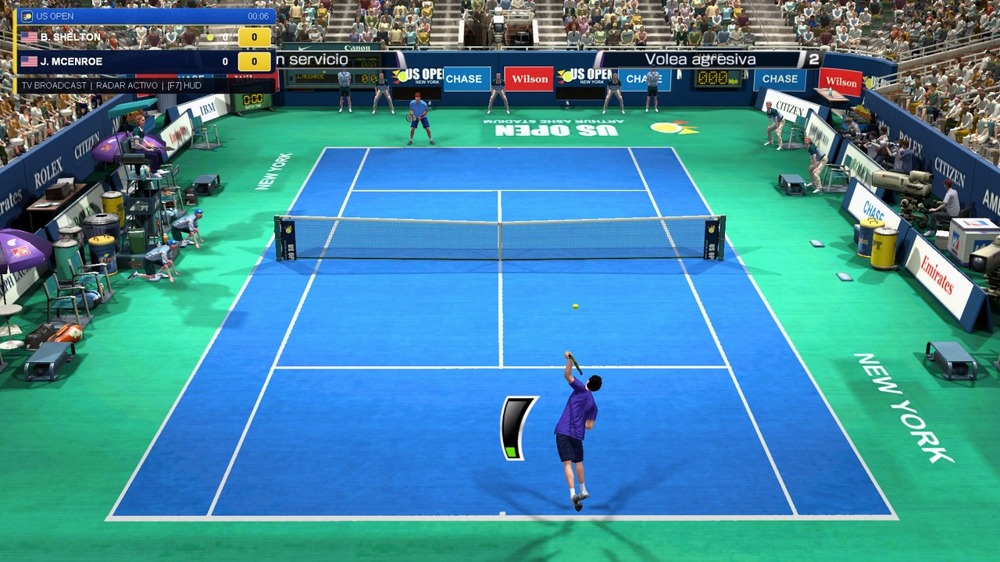
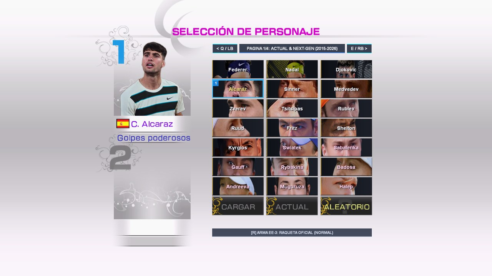
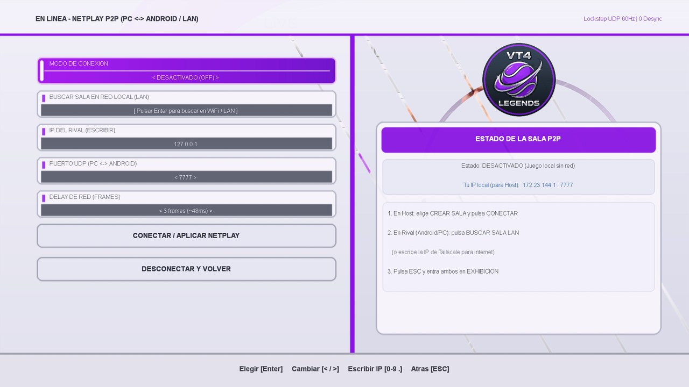
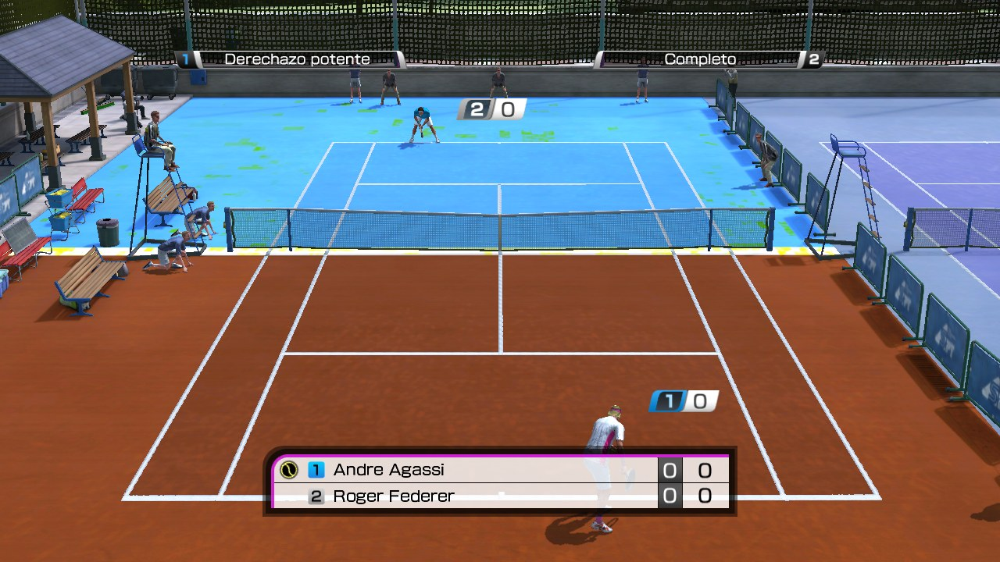

<p align="center">
  
</p>

<h1 align="center">Virtua Tennis 4: Legends &amp; Next-Gen Edition</h1>

<p align="center">
  <em>Native reverse engineering, GFWL-free <code>xlive.dll</code> mod loader, and full overhaul of Virtua Tennis 4 for PC &amp; Android.</em>
</p>

<p align="center">
  <a href="README.md"></a>
  <a href="README.es.md"></a>
</p>

<p align="center">
  
  
  
  
  
  
</p>

<p align="center">
  <a href="#-key-features">Features</a> •
  <a href="#-gallery">Gallery</a> •
  <a href="#-quick-start">Quick Start</a> •
  <a href="#-building--tools">Building</a> •
  <a href="#-controls--hotkeys">Controls</a> •
  <a href="#-real-benchmarks">Benchmarks</a> •
  <a href="#-faq--troubleshooting">FAQ</a>
</p>

---

> [!IMPORTANT]
> **Legal Notice:** This repository contains exclusively original mod source code (`src/`), asset generation tools (`tools/`), screenshots, and documentation. **It does not include or distribute any copyrighted SEGA files, executables, or proprietary assets** (`VT4.exe`, `vt4.dll`, `resource*.bin`, base models, or base textures). A legitimate PC copy of *Virtua Tennis 4* is required.

---

## ✨ Key Features

### 🏆 84-Player Historical &amp; Next-Gen Roster (`IDs 0..83`)
- **Native `CharaSelect` pagination** (`Q` / `E` or `LB` / `RB`) expanded from 26 to **84 playable athletes** organized across **4 era-based pages**, keeping all original SEGA characters intact.
- **59 custom 3D `.sdo` models**: 3DMM sculpted heads, **custom 3D UV face identities** ([local_identity_uv.py](tools/local_identity_uv.py) / [studio_face_factory.py](tools/studio_face_factory.py)), 4x-supersampled HD eyes, volumetric 3D hair, and physical bone scaling.
- **84/84 full-color 2D portraits** (`photo_L`, `photo_eye`, `photo_S`), **real in-match &amp; loading-screen names** (`hk_StoLookup` + `hk_Loading_SetPlayerPhoto`), individualized player stats ([player_stats.h](src/xlive/player_stats.h)), and an 84-ID voice table ([voice_packs.h](src/xlive/voice_packs.h)).
- **100% instant unlock (`EXTRA-1`)** for all legends, SEGA bosses (`King`, `Duke`, `T. Tenniel`, `V. Virnie`), stadiums, and SPT shop items out of the box.

<details>
<summary><b>View the full 4-page Roster (84 players)</b></summary>

- **Page 1/4 — Current Era &amp; Next-Gen (2015–2026)**: Federer, Nadal, Djokovic, Alcaraz, Sinner, Medvedev, Zverev, Tsitsipas, Rublev, Ruud, Fritz, Shelton, Kyrgios, Świątek, Sabalenka, Gauff, Rybakina, Badosa, Andreeva, Muguruza, Halep.
- **Page 2/4 — Golden Era (2000s–2010s)**: Del Potro, Murray, Wawrinka, Roddick, Hewitt, Safin, Ferrero, Moyá, Ferrer, Nalbandian, Coria, Tsonga, Monfils, Gasquet, Nishikori, González, Haas, Söderling, Berdych, Thiem, Serena Williams.
- **Page 3/4 — 90s Legends &amp; Classic WTA**: Sampras, Agassi (`[F]` dual `'91` / `'06` skin), Courier, Becker, Edberg, Rafter, Ivanišević, Kuerten, Chang, Ríos, Muster, Bruguera, Corretja, Graf, Seles, Henin, Clijsters, Sánchez Vicario, Conchita Martínez, Venus Williams, Sharapova.
- **Page 4/4 — 60s–80s Pioneers &amp; VT4 Classics**: Borg, McEnroe, Lendl, Connors, Vilas, Wilander, Laver, Navratilova, Evert, Billie Jean King, Wozniacki, Kuznetsova, Ivanovic, Chakvetadze, Robson, Kohlschreiber, Seppi, King, Duke, T. Tenniel, V. Virnie.

</details>

### 🏟️ 4 Official Grand Slams + Mutua Madrid Open (Blue Clay)
- **Australian Open (`Aus1`)**: Melbourne blue hard court and modern sponsors (Kia, Rolex, Emirates, Ralph Lauren, Yonex).
- **Roland-Garros (`Fra1`)**: Parisian red clay and Philippe-Chatrier backdrops (BNP Paribas, Rolex, Renault, Lacoste, Emirates, Babolat).
- **Wimbledon (`Eng1`)**: Natural-wear emerald grass and green/purple wraps (Rolex, IBM, Slazenger, Ralph Lauren, Barclays, evian).
- **US Open (`Usa1`)**: Arthur Ashe blue court + US Open green aprons (Chase, Wilson, Rolex, IBM, Emirates, Citizen) with legacy specular artifacts cleaned.
- **Mutua Madrid Open (`Spa2`)**: **Blue Clay** court generated via [make_madrid_blue_clay.py](tools/make_madrid_blue_clay.py).
- **Surface-specific physics + `ProPhysics`**: Tuned bounce and pace in `fwDataDB_Stage.txt` (high/slow clay `0.95/0.70`, low/fast grass `0.58/0.90`), speed selector (`0.90x` / `1.00x` / `1.20x` / `1.35x`), **Grand Slam Rules (5 Sets x 6 Games)**, and locked **Classic TV Camera**.

### 📺 Live Official TV Scoreboards (`[F7]`) &amp; NextGenFX Engine
- **Modular Broadcast TV Overlay** ([broadcast_hud.h](src/xlive/broadcast_hud.h), [build_official_scoreboards.py](tools/build_official_scoreboards.py)): 6 official tournament themes (`AO`, `RG`, `WIM`, `USO`, `MAD`, `TOUR`) + 27-flag IOC atlas.
- **Direct RAM telemetry**: live sets, games, points/advantage, serve indicator, *Break / Set / Match Point* banners, calibrated `km/h` ball speed radar, and `RALLY` counter.
- **NextGenFX &amp; Precision Frame Pacer**: Windows 10/11 D3D9 viewport fix, *DOF blur/bloom* cleanup (`CleanPostFX`), adaptive sharpening (`NextGenSharpen`), filmic grading (`NextGenFilmic`), keyboard return-of-serve fix (`Player+0x248`), and elimination of SEGA's double-VSync stutter bug (`30.77 -> 60.00 FPS`).

### 🌐 Native P2P Crossplay + Multiverse Arcade + 1-Tap Android
- **Native VT4 `EN LÍNEA` Menu + LAN Auto-Discovery** ([netplay.h](src/xlive/netplay.h)): full-screen pearl/magenta VT4 UI with UDP LAN room scanning (`Create Room` / `Search LAN`) and Internet play via Tailscale (`PC <-> Android`).
- **5 "Multiverse Arcade" Easter Eggs** ([multiverse_modes.h](src/xlive/multiverse_modes.h)): McEnroe chair-umpire protest (`EE-1`, `[C]` + QTE), **50% Ice / 50% Mud** split court (`EE-2`), **70s Wood Racket / Frying Pan / Giant Baguette** (`EE-3`, `[R]`), **DBZ Power Shots** (`EE-4`), and **Playable Bosses** (`EE-5`).
- **Turnkey Android Portability** ([export_android_bundle.py](tools/export_android_bundle.py)): native Win32 1-tap launcher **`PLAY_VT4_LEGENDS.exe`** for **GameHub** and **Winlator CMod/Frost**, mobile `PerfProfile=2` (0 FUSE syscalls), and interactive **Touch Xbox HUD (`[F6]`)** ([touch_gamepad.h](src/xlive/touch_gamepad.h)).

---

## 📸 Gallery

<table>
  <tr>
    <td align="center" width="50%">
      
      <br/><sub><b>Wimbledon (Eng1)</b> — Alcaraz vs Sinner · Official TV Scoreboard + 152 km/h radar</sub>
    </td>
    <td align="center" width="50%">
      
      <br/><sub><b>Roland-Garros (Fra1)</b> — Świątek vs Sabalenka · Philippe-Chatrier clay</sub>
    </td>
  </tr>
  <tr>
    <td align="center" width="50%">
      
      <br/><sub><b>US Open (Usa1)</b> — Shelton vs McEnroe · Arthur Ashe Stadium</sub>
    </td>
    <td align="center" width="50%">
      
      <br/><sub><b>84-Player Roster</b> — 4 era-sorted pages and full-color 2D portraits</sub>
    </td>
  </tr>
  <tr>
    <td align="center" width="50%">
      
      <br/><sub><b>Online P2P Netplay</b> — Native VT4 UI with UDP LAN auto-discovery</sub>
    </td>
    <td align="center" width="50%">
      
      <br/><sub><b>Multiverse Arcade (EE-2)</b> — Battle of Surfaces 50% Ice / 50% Mud</sub>
    </td>
  </tr>
</table>

---

## 🚀 Quick Start

### For Players (Windows &amp; Android)

1. **Prerequisites**:
   - A legitimate PC installation of *Virtua Tennis 4* (`VT4.exe`, `vt4.dll`, `resource.bin`, `resource.1.bin`).
   - On Android: **GameHub (GameFusion)** or **Winlator CMod / Frost** (Turnip on Adreno, Vortek on Mali).
2. **On PC (Windows)**:
   - Download the release package (no SEGA binaries included) or compile `xlive.dll` (see below).
   - Copy `xlive.dll`, `PLAY_VT4_LEGENDS.exe`, `vt4_settings.ini`, and `archive/` files into your `game/` folder alongside `VT4.exe`.
   - Launch **`VT4.exe`** (or **`PLAY_VT4_LEGENDS.exe`**) and configure graphics/mod options in **Options -> Gráficos HD y Legends (`F2`)**.
3. **On Android (1-Tap Launch)**:
   - Export a clean standalone bundle to `dist/android/VT4_Legends_Android/`:
     ```powershell
     py -u tools/export_android_bundle.py
     ```
   - Copy `VT4_Legends_Android/` to a short internal storage path (e.g. `/storage/emulated/0/Games/VT4_Legends_Android/`).
   - **GameHub**: *Import PC Game* -> select **`PLAY_VT4_LEGENDS.exe`**.
   - **Winlator CMod/Frost**: right-click **`PLAY_VT4_LEGENDS.exe`** -> *Create Shortcut* -> in *Shortcuts* tap `⋮` -> *Add to Home Screen*.
   - Full DXVK/Turnip tuning and netplay guides: [ANDROID_SETUP_GUIDE.md](ANDROID_SETUP_GUIDE.md) and [ONLINE_NETPLAY_GUIDE.md](ONLINE_NETPLAY_GUIDE.md).

---

## ⚙️ Building &amp; Tools

### For Developers (from source)

Local dependencies: Zig x86 compiler at `tools/zig/zig.exe` and Python 3.14 (`py -u` with `Pillow`, `numpy`, `opencv-python`).

```powershell
# 1. Build game/xlive.dll (Zig x86)
powershell -ExecutionPolicy Bypass -File src/xlive/build.ps1

# 2. (Optional) Rebuild the 4 Grand Slam stages into game/archive/HIGH/Stage/
py -u tools/build_grand_slam_stages.py

# 3. Export full Android bundle (compiles PLAY_VT4_LEGENDS.exe + case-sensitivity audit)
py -u tools/export_android_bundle.py

# 4. Run automated roster & options UI QA checks
py -u tools/tests/test_roster_matrix.py --ids 60,61,62,64,65,66,67,68,69,70,71,72,74,75,76,77,80,81,82,83 --cpu 0 --mv 3
py -u tools/tests/test_options_ui.py
```

---

## 🎮 Controls &amp; Hotkeys

| Context | Key / Button | Action |
|---|---|---|
| Global / In-game | `F2` | Open **Gráficos HD y Legends** settings overlay |
| Global / In-game | `F6` | Toggle **Touch Xbox Controller HUD (`TouchXboxHUD`)** |
| In-match | `F7` | Toggle **Official TV Scoreboard (`BroadcastHUD`)** |
| In-match | `F10` | Clean D3D9 backbuffer screenshot (`vt4_present_*.png`) |
| `CharaSelect` | `Q` / `E` (`LB` / `RB`) | Switch between the **4 roster pages** |
| `CharaSelect` | `F` | Toggle **Agassi '91 / '06** skin |
| `CharaSelect` | `R` | Cycle **EE-3** arcade weapon (Normal / Wood / Frying Pan / Baguette) |
| In-match (`EE-1`) | `C` | Protest umpire call (QTE with `Z` / `Space`) |
| Tennis (P1 keyboard) | Arrows + `Enter` / `Esc` / `Z` / `V` | Move + Topspin / Slice / Lob / Drop shot (native XInput / DirectInput supported) |

---

## 📊 Real Benchmarks

Measured in live Exhibition matches (300 frames, native XAudio2 enabled, `0` crashes):

| Metric | Stock VT4 (`VSync=1`) | Stock (`VSync=0`) | Mod `PerfProfile=0` (Ultra PC) | Mod `PerfProfile=2` (Android / Winlator) |
|---|---:|---:|---:|---:|
| **Average FPS** | 30.77 | 60.24 | **60.00 (+95.0%)** | **60.00** |
| **1% Low FPS** | 28.12 | 45.27 | **59.93 (+113.1%)** | **59.92** |
| **Frame Time Avg / P99 / Max** | 32.50 / 34.76 / 36.90 ms | 16.60 / 16.99 / 28.62 ms | **16.67 / 16.67 / 16.72 ms** | **16.67 / 16.67 / 16.70 ms** |
| **Jitter (max - min)** | 5.90 ms | 12.48 ms | **0.10 ms** | **0.06 ms** |
| **I/O Syscalls (`GetFileAttributesA`)** | 2,453 | 2,448 | **0 (-100%)** | **0 (-100%)** |
| **Crashes / Asserts** | 28 | 0 | **0 (`ps=0 ex=0 exc=0`)** | **0 (`ps=0 ex=0 exc=0`)** |

---

## ❓ FAQ &amp; Troubleshooting

<details>
<summary><b>The game boots with only the original 26 players instead of 84</b></summary>
Wine / Windows did not load our custom <code>xlive.dll</code>. On Android/Wine always launch <code>PLAY_VT4_LEGENDS.exe</code> (or set <code>WINEDLLOVERRIDES="xlive,d3dx9_43,msvcr90,msvcp90,msvcm90=n,b"</code>).
</details>

<details>
<summary><b>No audio or crackling sound on Winlator / GameHub</b></summary>
Set <code>xaudio2_7=n</code> (Native) and select <b>PulseAudio</b> as your container audio driver.
</details>

<details>
<summary><b>Black screen or crashes on Mali / Exynos phones</b></summary>
Keep <code>AntiAliasing=0</code>, <code>CleanPostFX=1</code>, <code>PerfProfile=2</code> in <code>vt4_settings.ini</code> (preconfigured by <code>export_android_bundle.py</code>) and use <b>Vortek</b> + <b>DXVK</b>.
</details>

<details>
<summary><b>How do I play online between PC and Android?</b></summary>
Open <b>EN LÍNEA</b> from the main menu on both devices: on the same WiFi one hosts and the other clicks <b>BUSCAR SALA EN RED LOCAL (LAN)</b>; over the Internet use <b>Tailscale</b> and enter your opponent's <code>100.x.x.x</code> IP.
</details>

---

## 🛠️ Project Structure

```text
├── docs/screenshots/                   # Curated screenshot gallery and crest
├── src/
│   ├── launcher/
│   │   └── play_vt4_legends.c          # Win32 1-tap launcher (WINEDLLOVERRIDES + WaitForSingleObject)
│   └── xlive/
│       ├── xlive.c                     # Native Mod Loader (GFWL bypass, D3D9, PlayerDB, engine hooks)
│       ├── broadcast_hud.h             # Official TV Scoreboards [F7] + km/h radar & RALLY counter
│       ├── touch_gamepad.h             # Interactive Touch Xbox Controller HUD [F6]
│       ├── player_stats.h              # Individualized player stats (IDs 26..83)
│       ├── voice_packs.h               # Voice pack table (84 IDs)
│       ├── multiverse_modes.h          # Easter Eggs EE-1..EE-5 (Ice/Mud, 3D weapons, shot trails)
│       ├── nextgen_fx.h / perf_opt.h   # NextGenFX shaders & performance profiles
│       ├── netplay.h                   # Lockstep P2P UDP sync + LAN discovery
│       └── xlive.def / build.ps1       # XLive exports & Zig x86 build script
├── tools/
│   ├── build_grand_slam_stages.py      # BC1/BC3 + LZSS stage builder (AO, RG, Wimbledon, US Open)
│   ├── build_official_scoreboards.py   # TV Scoreboard overlays & IOC flag atlas builder
│   ├── build_netplay_ui_assets.py      # Native EN LÍNEA UI sprite builder
│   ├── make_madrid_blue_clay.py        # Madrid Blue Clay builder (Spa2FS/D)
│   ├── build_all_sdo_models.py         # 3D .sdo / .zml model & physique scaler pipeline
│   ├── studio_face_factory.py          # 3DMM head sculpting + 3D hair + UV baking
│   ├── local_identity_uv.py            # Biometric facial identity transfer to 1024x1024 UV
│   ├── pack_colorized_bw_portraits.py  # 84/84 full-color 2D portrait packer
│   ├── export_android_bundle.py        # Turnkey Android exporter + PLAY_VT4_LEGENDS.exe + case audit
│   └── tests/                          # Automated QA suites (test_roster_matrix, test_options_ui)
├── README.md / README.es.md            # English & Spanish documentation
├── ROADMAP_ROSTER.md                   # Master 84/84 roster tracker & development phases
├── MODLOG.md                           # Technical session & verification log
├── RELEASE_NOTES_v1.0.md               # Official v1.0 release notes
├── ONLINE_NETPLAY_GUIDE.md             # P2P & LAN netplay guide
└── ANDROID_SETUP_GUIDE.md              # Android tuning guide (GameHub / Winlator)
```
